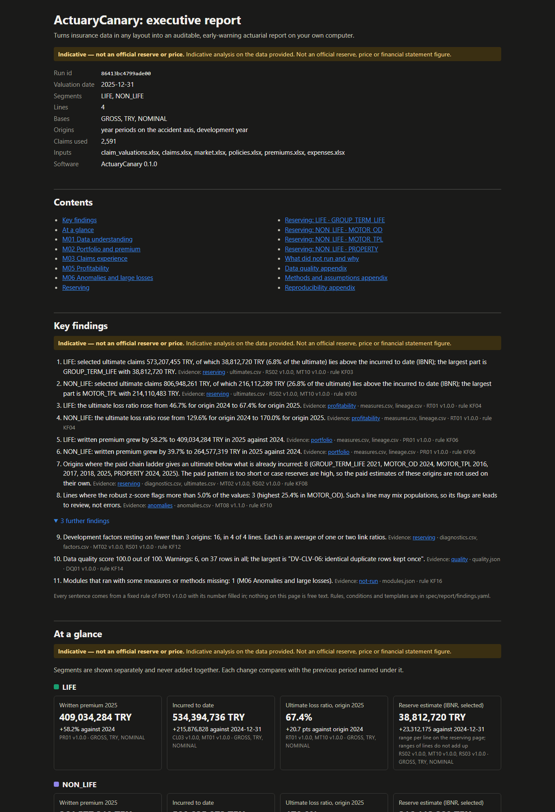

# ActuaryCanary

Turns insurance data in any layout into an auditable, early-warning actuarial report on your own computer.

Give it your claim, policy, premium, expense and market spreadsheets, whatever the column names. It recognises what each sheet contains, asks you to confirm the mapping once, checks the data quality, builds the development triangles, runs the reserving and anomaly methods and writes one self-contained report page. Every number in the report traces back to the input rows, the mapping, the parameters and the method version that produced it. Nothing leaves your machine.



*The first page of the report of the demo example (synthetic data). The full report is [examples/demo/report/report.html](examples/demo/report/report.html): download it and open it in a browser.*

All outputs are indicative analyses, never official reserves or prices.

## Quick start

### The Windows program

Download the release archive from the [releases page](https://github.com/furkzel/ActuaryCanary/releases), unzip it and open the `canary` folder. The program is run from **PowerShell**, not by double-clicking: in Explorer, click the address bar of the `canary` folder, type `powershell` and press Enter. Then type:

```
.\canary.exe demo                      # the bundled synthetic example; opens the report
.\canary.exe run C:\path\to\yourfolder   # your own files
```

(Double-clicking `canary.exe` only shows a short message and waits for a key.) What to expect on the first run: a few seconds to start, and up to about half a minute the very first time while Windows scans the new files. The program is not signed, so Windows SmartScreen may say it protected your PC: click **More info**, then **Run anyway**. An antivirus program may also ask or warn; allow the program if you trust where you got it. Nothing is sent anywhere.

### From source

You need [uv](https://docs.astral.sh/uv/); it fetches Python 3.12 and the libraries.

```
git clone https://github.com/furkzel/ActuaryCanary.git
cd ActuaryCanary
uv sync
uv run canary demo                           # the bundled synthetic example; opens the report
uv run canary run path/to/your/folder        # your own files
```

`canary demo` is a command of its own: it runs on the example data that ships with the program ([examples/demo/](examples/demo/); it never asks, since the layouts are the platform's own), writes the report to `out/<run id>/report.html` and opens it in your browser (`--no-open` leaves the browser alone, `--out` changes the output folder). It takes a few seconds to about ten seconds. The run id and every output are the same as those of `canary run examples/demo --yes`, which is how the tests compare them. For your own data, put the spreadsheets in one folder (only `claim_valuations.xlsx` is required; see the [guide](docs/guide.md#2-preparing-the-six-input-files)), run `canary run <folder>` and confirm the column mappings when asked. The terminal prints a summary and the path of the report.

## What you get

- A **data quality score** and every rule that was touched, with example rows by file, sheet and row number.
- **Triangles** of paid, incurred and claim counts, **chain ladder**, Bornhuetter–Ferguson, Cape Cod and expected loss ratio, a **Mack range**, an **inflation-adjusted** chain ladder and one selected ultimate per origin, all by segment and line, on gross, ceded or net basis.
- **Loss, expense and combined ratios**, portfolio and claims experience, and **anomaly flags** (robust z-score and isolation forest).
- **Key findings** in fixed, deterministic wording, each with its evidence.
- A **run manifest** and a **lineage table**: rerun the same inputs and every output is byte-identical.

The methods are checked against hand-worked fixtures, benchmark triangles and synthetic data whose true answer is known. The [method notes](docs/methods/MT02-chain-ladder.md) give the theory, the assumptions and a worked example of each.

## Documentation

- [docs/guide.md](docs/guide.md): preparing the input files, the mapping confirmation, reading each report page, the run folder, common problems.
- [docs/methods/](docs/methods/): one note per method, with formulas, assumptions and a worked example computed by the platform's own code.
- [examples/](examples/): the demo (ten accident years), the tiny baseline and the same data with messy headers, each with its report.
- [docs/blueprint.md](docs/blueprint.md): what the platform is and how it is built. [spec/](spec/): every rule, measure, method and module as one specification file. [docs/decisions/](docs/decisions/): why each choice was made.
- [CONTRIBUTING.md](CONTRIBUTING.md), [CHANGELOG.md](CHANGELOG.md), [HANDOVER.md](HANDOVER.md): how to work here, what changed, current state and next steps.

## Development

```
just setup        # uv sync and the pre-commit hook (install just with `uv tool install rust-just`)
just check        # format, lint, types, fast tests (under 30 seconds), including the docs check
just test-all     # everything, including the slow tests
```

## Licence

[MIT](LICENSE), copyright ActuaryCanary contributors.
